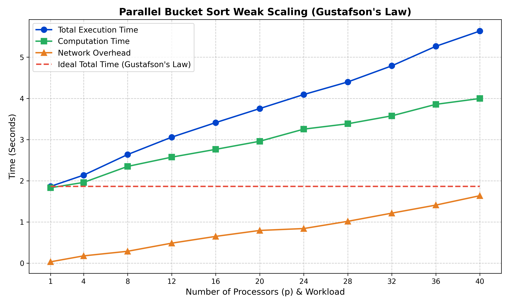

# Parallel Bucket Sort: Weak Scaling & Gustafson's Law Analysis

This repository contains a high-performance, parallelized implementation of the Bucket Sort algorithm written in C++ using the Message Passing Interface (MPI). The primary objective of this project is to evaluate the algorithm's scalability across a distributed computing cluster, focusing on weak scaling and its adherence to Gustafson's Law.

Alongside the core MPI source code, this project includes a SLURM batch execution script and a Python data visualization tool to empirically analyze inter-node network bottlenecks during massive collective communication routines (`MPI_Alltoallv` and `MPI_Gatherv`).

## Files in this Repository
* `main_gustafsons.cpp`: The core C++ MPI parallel bucket sort implementation.
* `job_gustafsons.sh`: The SLURM batch script configured to execute 11 scaling tests (from 1 to 40 processors) while maintaining a strict workload of 10,000,000 elements per processor.
* `plot_gustafsons_law.py`: A Python Matplotlib script that processes the cluster output to graph the performance deviation from ideal weak scaling.
* `assignment2_gustafson_graph.png`: The generated data visualization.

## Prerequisites
To compile and run this code, your environment requires:
* C++ Compiler (`g++`)
* MPI Library (OpenMPI or MPICH)
* SLURM Workload Manager (for cluster execution)
* Python 3 & Matplotlib (for visualization)

## Compilation and Execution
To compile the C++ source code using the MPI wrapper:
```bash
mpic++ main_gustafsons.cpp -o main_gustafsons
 ```

To execute the weak scaling benchmark suite on a SLURM-managed HPC cluster:

```Bash
sbatch job_gustafsons.sh
```
Note: The batch script utilizes the --mca pml ucx flag to enforce the Unified Communication X transport layer for optimized network routing.

Performance Analysis & Data Visualization
The experimental design evaluates Gustafson's Law by scaling the problem size proportionally with the processor count. The Python script (plot_gustafsons_law.py) graphs the resulting output, distinctly separating pure mathematical computation time from inter-node network overhead.

Scalability Results
The visual analysis illustrates that while the isolated computation time remains relatively flat across nodes (adhering to Gustafson's Law), the exponential growth in inter-process network contention during the MPI_Alltoallv and MPI_Gatherv phases serves as the primary bottleneck preventing perfect weak scaling efficiency.


## Sample Output



**Author**<br>
Subrota Debnath<br>
Master of Information Sciences<br>
Massey University
